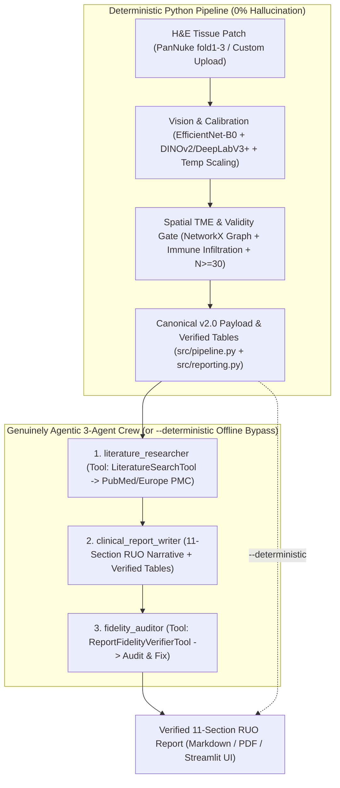

# BioCellAgents

> **AI-Powered Computational Pathology, Spatial Biology & Tool-Using Multi-Agent Platform**

By **Ghsoun Zin** · [GitHub](https://github.com/g-zin) · [LinkedIn](https://www.linkedin.com/in/ghsoun-zin)

---

## What

**BioCellAgents** is an end-to-end, GPU-accelerated computational pathology platform that transforms PanNuke H&E tissue patches (`256x256`) or custom uploaded histopathology tiles into calibrated multi-organ predictions, 5-class cellular spatial graphs, statistical validity audits, and verified Research-Use-Only (RUO) pathology reports.

It combines:
- **GPU-First Deep Learning Vision Models**: **EfficientNet-B0** (19-class PanNuke organ classifier), **DINOv2 ViT-S/14** (5-class single-cell classifier & semantic segmenter), **DeepLabV3+ (ResNet50 + ASPP)** segmenter, and **Cellpose-SAM v2** zero-shot instance adapter — unified through centralized device, AMP, and PyTorch 2.7+ safe checkpoint utilities (`src/utils/device.py`).
- **Confidence Calibration & Validity Gating**: L-BFGS **Temperature Scaling** (`TemperatureScaler` + `compute_ece`) and minimum-sample **Statistical Validity Gate** (`ValidityGate`, $N \ge 30$ total cells, $N \ge 5$ per class).
- **Spatial TME Topology & Deterministic Reporting**: **NetworkX** proximity graphs (`SpatialGraphAnalytics`) + pure-Python deterministic extraction & Markdown/PDF table generation (`src/reporting.py`) with 0% numeric drift and an instant `--deterministic` zero-LLM mode.
- **Genuinely Tool-Using 3-Agent Crew (`PathologyCrew`)**:
  1. `literature_researcher` — wired with `LiteratureSearchTool` (PubMed + Europe PMC) for adaptive query refinement.
  2. `clinical_report_writer` — synthesizes verified quantitative tables and curated literature into an 11-section RUO report.
  3. `fidelity_auditor` — wired with `ReportFidelityVerifierTool` to programmatically score and audit numeric fidelity, 11-section structure, table formatting, Vancouver PMID grounding (zero fabricated PMIDs), and RUO compliance in a closed loop.
- **Dual-Layer Automated Eval Harness (`src/evals/` & `scripts/run_evals.py`)**: Benchmarks ML/spatial vision (Dice, IoU, Panoptic Quality, Macro F1, ECE reduction, 3-state TME phenotyping, ValidityGate boundaries) and grades report fidelity across compliant & 5 adversarial hallucination probes.
- **Clinical Dark Precision Dashboard (`app.py` / `biocell_app.py`)**: Dark-theme Streamlit platform with live GPU/CPU telemetry badge, multi-fold (`fold1`–`fold3`) + custom H&E upload, Okabe-Ito colorblind-safe palette toggle, interactive Plotly spatial maps, PDF/Markdown report export, grounded Q&A, and an integrated Eval Benchmark tab.

---

## Why

Raw pathology vision models emit overconfident probabilities and pixel masks without spatial tissue context, sample-size safeguards, or peer-reviewed grounding. Conversely, forcing LLM agents to copy JSON numbers without real tools adds latency and hallucination risk.

BioCellAgents separates **what must be deterministic** from **where agentic reasoning adds real value**:
1. **100% Deterministic Quantitative Pipeline (`src/pipeline.py` + `src/reporting.py`)**: Vision inference, temperature scaling, spatial graph metrics, `px` → `μm` (`0.25 μm/px`) conversion, and Markdown tables run strictly in Python with 0% hallucination.
2. **Closed-Loop Tool-Using 3-Agent Synthesis (`src/crew.py`)**: Agents focus exclusively on adaptive PubMed/Europe PMC search, grounded translational narrative synthesis, and programmatic verification via `ReportFidelityVerifierTool`.

---

## Impact

- **Zero-Drift Quantitative Reporting**: Deterministic table scaffolding + a 100-point 6-rubric programmatic fidelity grader catches 100% of tested adversarial failure modes (altered cell counts, fabricated PMIDs, non-PanNuke cell classes, diagnostic language, missing sections).
- **GPU-Accelerated & CI-Reproducible**: Automatic `cuda` → `mps` → `cpu` selection, FP16 AMP, `pin_memory`, and PyTorch 2.7+ safe checkpoint loading ensure seamless execution on NVIDIA GPUs (including RTX 50-series `cu128`) while every unit test, Streamlit `AppTest`, and synthetic dual-layer eval runs reproducibly on CPU in CI.

> **Note on Artifacts:** PanNuke datasets (`data/`), trained model weights (`checkpoints/`), evaluation outputs (`results/`), and generated reports (`reports/`) are gitignored and produced locally on your workstation.

---

## How

### Architecture



### Quick Start (GPU & CPU)

```bash
# 1. Clone & create environment
git clone https://github.com/g-zin/BioCellAgents.git
cd BioCellAgents
python -m venv .venv && source .venv/bin/activate   # Windows: .venv\Scripts\activate

# 2a. Install PyTorch for NVIDIA RTX 50-series (Blackwell, CUDA 12.8)
pip install torch torchvision --index-url https://download.pytorch.org/whl/cu128
# 2b. Or standard CUDA / CPU install:
pip install -e ".[dev]"

# 3. Configure environment (optional for --deterministic offline mode)
cp .env.example .env   # add GROQ_API_KEY (and optional MODEL)

# 4. Verify hardware & pipeline
python scripts/verify_pipeline.py             # GPU/CPU pretrained verification
python scripts/verify_pipeline.py --offline   # Zero-network verification

# 5. Launch Clinical Dark Precision Dashboard or CLI
streamlit run app.py
python main.py --fold_dir data/raw/fold3 --patch_index 0 --deterministic
```

### Usage & Commands

| Task | Command |
|---|---|
| Clinical Dark Precision Dashboard | `streamlit run app.py` |
| 3-Agent CrewAI CLI (PanNuke fold) | `python main.py --fold_dir data/raw/fold3 --patch_index 0` |
| Offline Deterministic 11-Sec Report | `python main.py --fold_dir data/raw/fold3 --patch_index 0 --deterministic` |
| Analyze Custom H&E Image | `python main.py --image path/to/patch.png --deterministic` |
| Dual-Layer Synthetic Eval Harness | `python scripts/run_evals.py --mode synthetic --fail-on-error` |
| Dual-Layer Real GPU Eval Harness | `python scripts/run_evals.py --mode real --device cuda` |
| Train Cell Segmenter | `python -m src.models.train --train_fold 1,2 --val_fold 3` |
| Train Cell Classifier | `python -m src.models.train_classification --train_fold 1,2 --val_fold 3` |
| Full 3-Stage Training | `python -m src.models.train_complete --train_fold 1,2 --val_fold 3` |
| Fit Temperature Calibration | `python scripts/fit_calibration.py --fold fold2 --seed 42` |
| Evaluate All 3 Models (`fold3`) | `python scripts/evaluate_all.py --tasks cell organ segmentation` |
| Benchmark 4 Segmenters (`fold3`) | `python scripts/benchmark_segmenters.py --fold fold3` |
| Full Test Suite + Coverage | `pytest tests/ -v --tb=short --cov=src` |

### Docker

```bash
# GPU-enabled Streamlit Dashboard (:8501)
docker compose up -d biocell-app

# Run Dual-Layer Synthetic Eval Gate in Docker
docker compose --profile eval run --rm biocell-eval

# GPU Batch Trainer & Local Ollama LLM
docker compose --profile training up -d
docker compose --profile agent up -d

# Custom CPU-only or RTX 50-series cu128 Docker image builds
docker build --build-arg TORCH_INDEX_URL=https://download.pytorch.org/whl/cpu -t biocell-agent:cpu .
docker build --build-arg TORCH_INDEX_URL=https://download.pytorch.org/whl/cu128 -t biocell-agent:cu128 .
```

### Quality Gates

```bash
flake8 src/ scripts/ tests/ app.py biocell_app.py main.py --max-line-length=120 --extend-ignore=E203,W503
black --check src/ scripts/ tests/ app.py biocell_app.py main.py
isort --check-only src/ scripts/ tests/ app.py biocell_app.py main.py
mypy --no-incremental src/ scripts/
pytest tests/ -v --tb=short --cov=src
python scripts/run_evals.py --mode synthetic --fail-on-error
```

### Project Structure

```text
BioCellAgents/
├── src/
│   ├── data/           # PanNuke constants, PyTorch datasets, image/label transforms
│   ├── models/         # DINOv2 classifier/segmenter, DeepLabV3+, EfficientNet-B0, Cellpose, trainers
│   ├── inference/      # TemperatureScaler, compute_ece, ValidityGate, Evaluator, Metrics, Tuner
│   ├── evals/          # Dual-Layer Eval Harness (ml_vision_eval, report_fidelity_eval, runner)
│   ├── tools/          # SpatialGraphAnalytics, LiteratureSearchTool, ReportFidelityVerifierTool, parsers
│   ├── dashboard/      # Clinical Dark Precision CSS, Okabe-Ito palettes, Plotly charts, explorer
│   ├── utils/          # GPU/CPU device & safe checkpoint utils, structured logging, metrics tracker
│   ├── pipeline.py     # Canonical v2.0 deterministic vision + spatial pre-computation
│   ├── reporting.py    # Deterministic 11-section RUO report engine + PDF/Markdown export
│   └── crew.py         # Tool-using 3-agent PathologyCrew + GroqCompatibleLLM
├── config/             # 3-agent agents.yaml & tasks.yaml
├── scripts/            # run_evals, verify_pipeline, evaluate_all, benchmark_segmenters, fit_calibration, diag_dice
├── tests/              # Comprehensive unit, integration, eval & Streamlit AppTest suites
├── app.py              # Streamlit entry point
├── biocell_app.py      # Clinical Dark Precision Streamlit application
├── main.py             # CLI entry point (3-agent CrewAI & --deterministic modes)
├── Dockerfile
├── docker-compose.yml
└── pyproject.toml
```

---

## Author & License

Created and maintained by **Ghsoun Zin** ([GitHub](https://github.com/g-zin) · [LinkedIn](https://www.linkedin.com/in/ghsoun-zin)).

Licensed under the [MIT License](LICENSE).
