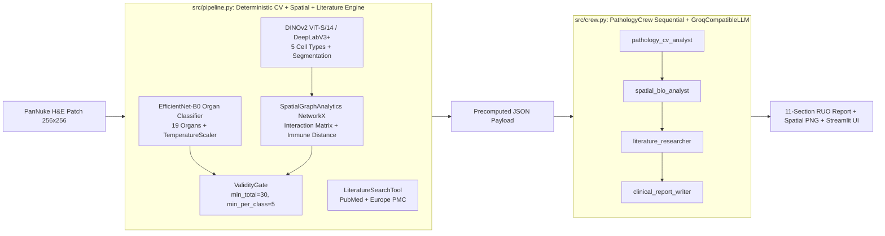

# BioCellAgents

> **AI-Powered Computational Pathology & Multi-Agent Spatial Biology Platform**

By **Ghsoun Zin** · [GitHub](https://github.com/g-zin) · [LinkedIn](https://www.linkedin.com/in/ghsoun-zin)

---

## What

**BioCellAgents** is an end-to-end computational pathology system that turns raw PanNuke H&E tissue patches (`256x256`) into calibrated organ predictions, 5-class cellular spatial graphs, statistical validity audits, and literature-grounded Research-Use-Only (RUO) pathology reports.

It combines:
- **Deep Learning Vision Models**: **EfficientNet-B0** (19-class PanNuke organ classifier), **DINOv2 ViT-S/14** (5-class single-cell classifier and patch segmenter), and **DeepLabV3+ (ResNet50 + ASPP)** dense semantic segmenter.
- **Confidence Calibration & Validity Gating**: L-BFGS **Temperature Scaling** (`TemperatureScaler`, default $\tau = 2.0$) and minimum-sample **Statistical Validity Gate** (`ValidityGate`, $N \ge 30$ total cells, $N \ge 5$ per class).
- **Spatial TME Topology Engine**: **NetworkX** proximity graphs (`SpatialGraphAnalytics`) computing interaction matrices, clustering coefficients, cellular density, and immune-to-tumor Euclidean infiltration distances.
- **Grounded Multi-Agent Synthesis**: **PubMed & Europe PMC** pre-retrieval (`LiteratureSearchTool`) feeding a 4-agent **CrewAI** sequential crew (`PathologyCrew` with `GroqCompatibleLLM`) that produces an 11-section RUO Markdown report and powers an interactive **Streamlit** dashboard (`app.py` / `biocell_app.py`).

---

## Why

Raw pathology vision models emit uncalibrated softmax probabilities and isolated pixel masks without spatial tissue context, sample-size safeguards, or peer-reviewed grounding. Conversely, letting LLM agents call vision/search tools freely risks fabricated metrics, ungrounded biological claims, and provider tool-calling failures (`cache_breakpoint` / `tool_use_failed`).

BioCellAgents solves this by **decoupling deterministic pre-computation (`src/pipeline.py`) from constrained multi-agent synthesis (`src/crew.py`)**:
1. All quantitative vision, calibration, graph topology, and literature retrieval steps run deterministically before the crew starts.
2. The 4-agent crew (`pathology_cv_analyst` → `spatial_bio_analyst` → `literature_researcher` → `clinical_report_writer`) operates strictly on the pre-computed JSON payload with verbatim numeric reporting rules and Vancouver PMID citations.

---

## Impact

- **Reproducible Quantitative Payloads**: Produces structured JSON containing calibrated top-3 organ predictions, temperature $\tau$, 5-class cell counts, Voronoi class-specific segmentation overlays, NetworkX topology metrics, immune infiltration distances (in `px` and `µm` at 40x), validity warnings, and PubMed/Europe PMC citations.
- **Interactive Clinical Research Explorer**: Dark-theme Streamlit dashboard (`app.py`) with H&E patch inspection, Plotly charts, class-colored Voronoi mask overlays, live 4-task CrewAI progress tracking, and **Chat with the Slide** grounded strictly in computed patch data.
- **Reproducible Evaluation & Benchmarking**: Includes standalone scripts for held-out PanNuke `fold3` evaluation (`scripts/evaluate_all.py`), head-to-head 4-segmenter comparison (`scripts/benchmark_segmenters.py`), and confidence calibration fitting (`scripts/fit_calibration.py`).

> **Note on Artifacts:** PanNuke datasets (`data/`), trained model weights (`checkpoints/`), evaluation outputs (`results/`), and generated reports (`reports/`) are gitignored and generated locally on your machine—no synthetic or hardcoded benchmark scores are committed to this repository.

---

## How

### Architecture



### Quick Start

```bash
# 1. Clone & install
git clone https://github.com/g-zin/BioCellAgents.git
cd BioCellAgents
python -m venv .venv && source .venv/bin/activate   # Windows: .venv\Scripts\activate
pip install -e ".[dev]"

# 2. Configure environment
cp .env.example .env   # add your GROQ_API_KEY (and optional MODEL)

# 3. Prepare PanNuke data (see Data Setup below)

# 4. Run CLI pipeline or Streamlit dashboard
python main.py --fold_dir data/raw/fold1 --patch_index 0
streamlit run app.py
```

**Prerequisites:** Python `>= 3.10` (tested on 3.10 & 3.11), CUDA 11.8+ (optional; CPU supported), and a Groq API key (only required for CrewAI synthesis and slide chat).

### Data Setup

Download the [PanNuke Challenge](https://pannuke.grand-challenge.org) dataset (`images.npy`, `masks.npy`, `tissues.npy`) and organize locally under `data/` (gitignored):

```text
data/
├── raw/
│   ├── fold1/          # images.npy, masks.npy, tissues.npy
│   ├── fold2/
│   └── fold3/          # held-out test fold
└── processed/
    ├── fold1/crops/
    └── metadata.csv
```

### Usage & Commands

| Task | Command |
|---|---|
| Web dashboard | `streamlit run app.py` |
| Multi-agent CLI pipeline | `python main.py --fold_dir data/raw/fold1 --patch_index 0` |
| Train cell segmenter | `python -m src.models.train --train_fold 1,2 --val_fold 3` |
| Train cell classifier | `python -m src.models.train_classification --train_fold 1,2 --val_fold 3` |
| Full 3-stage training | `python -m src.models.train_complete --train_fold 1,2 --val_fold 3` |
| Single-image inference CLI | `biocell-infer --image path/to/patch.png` |
| Fit temperature calibration (`fold3`) | `python scripts/fit_calibration.py` |
| Evaluate all 3 models (`fold3`) | `python scripts/evaluate_all.py --tasks cell organ segmentation` |
| Benchmark 4 segmenters (`fold3`) | `python scripts/benchmark_segmenters.py` |
| Run offline unit tests | `pytest tests/ -v --tb=short --cov=src` |

### PanNuke Evaluation & Benchmarking Workflow

When PanNuke data and trained checkpoints are present locally:
1. **Confidence Calibration (`scripts/fit_calibration.py`)**: Fits optimal `TemperatureScaler` temperature $\tau$ via L-BFGS minimizing NLL on held-out `fold3` and writes `checkpoints/organ_vits14/calibration.json`.
2. **Independent 3-Task Harness (`scripts/evaluate_all.py`)**: Evaluates `DINOv2CellClassifier` (5 cell classes), `OrganClassifier` (19 PanNuke organs), and `DINOv2CellSegmenter` (6-class segmentation) on `fold3`, generating `results/eval_report.json`, `results/eval_report.md`, `confusion_cell.png`, `confusion_organ.png`, and `segmentation_samples/`.
3. **4-Way Segmenter Benchmark (`scripts/benchmark_segmenters.py`)**: Compares fine-tuned `DINOv2CellSegmenter` and `DeepLabV3PlusSegmenter` against zero-shot `StarDist2D` (`2D_versatile_he`, install optional `pip install -e ".[segmentation-bench]"`) and `Cellpose` (`cpsam_v2`) on identical `fold3` patches, reporting Foreground Dice and per-class Dice to `results/segmentation_benchmark.json` and `reports/model_scorecard.md`.

### Docker

```bash
docker compose up -d biocell-app                           # Streamlit dashboard on :8501
docker compose --profile training up -d                    # Batch segmentation trainer
docker compose --profile training --profile agent up -d    # + local Ollama service
```

### Development & Quality Checks

```bash
flake8 src/ tests/ app.py biocell_app.py main.py --max-line-length=120 --extend-ignore=E203,W503
black --check src/ tests/ app.py biocell_app.py main.py
isort --check-only src/ tests/ app.py biocell_app.py main.py
mypy src/
pytest tests/ -v --tb=short --cov=src
```

### Project Structure

```text
BioCellAgents/
├── src/
│   ├── data/           # PanNuke constants, PyTorch datasets, image/label transforms
│   ├── models/         # DINOv2 classifier/segmenter, DeepLabV3+, EfficientNet-B0, Cellpose, trainers
│   ├── inference/      # TemperatureScaler, ValidityGate, Evaluator, Metrics, HyperparameterTuner
│   ├── tools/          # SpatialGraphAnalytics, PanNukeParserTool, LiteratureSearchTool, CellTypeClassifierTool
│   ├── dashboard/      # Reusable Plotly chart builders, cell explorer, styles
│   ├── utils/          # Structured logging and metrics tracking
│   ├── pipeline.py     # Deterministic pre-computation engine
│   └── crew.py         # 4-agent CrewAI PathologyCrew + GroqCompatibleLLM
├── config/             # agents.yaml & tasks.yaml
├── scripts/            # fold3 evaluation, 4-segmenter benchmark, temperature calibration
├── tests/              # Offline CPU unit tests
├── app.py              # Streamlit entry point
├── biocell_app.py      # Full Streamlit dashboard implementation
├── main.py             # CLI multi-agent pipeline entry point
├── Dockerfile
├── docker-compose.yml
└── pyproject.toml
```

---

## Author & License

Created and maintained by **Ghsoun Zin** ([GitHub](https://github.com/g-zin) · [LinkedIn](https://www.linkedin.com/in/ghsoun-zin)).

Licensed under the [MIT License](LICENSE).
