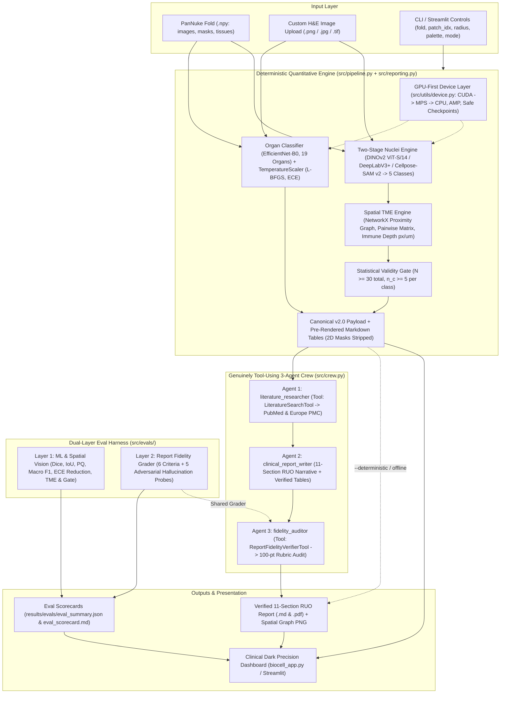
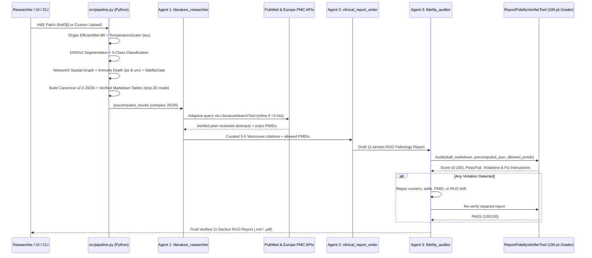
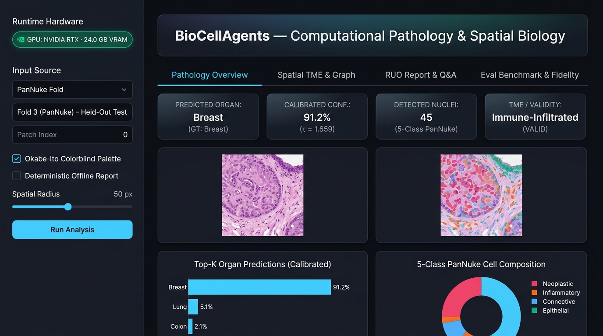
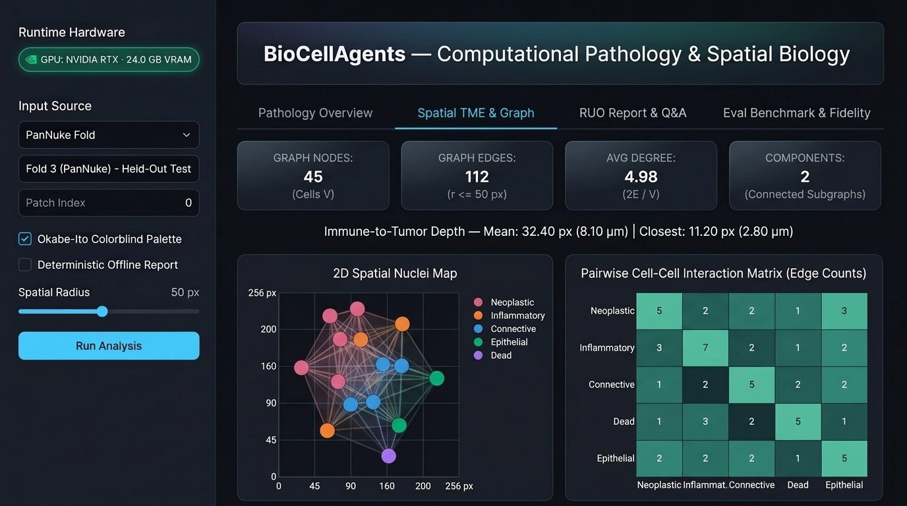
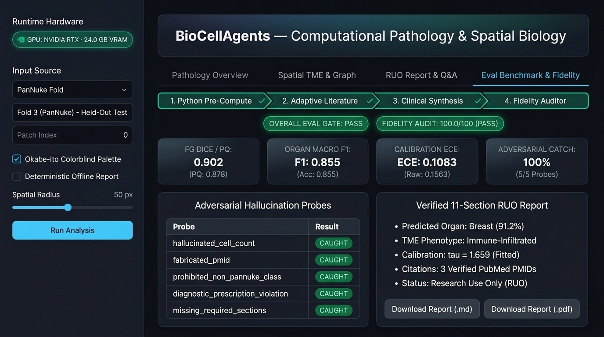

# BioCellAgents — System Design & Architecture Document

**Version:** 2.0  
**Repository:** [g-zin/BioCellAgents](https://github.com/g-zin/BioCellAgents)  
**Scope:** End-to-End Computational Pathology, Spatial Biology, Tool-Using Multi-Agent Synthesis, Dual-Layer Eval Harness & Clinical Dark Precision Frontend

---

## 1. Problem Statement & Motivation

Computational pathology models trained on histopathology datasets like **PanNuke** (19 organs, 5 nuclear classes across 256×256 H&E tiles at 40× magnification) suffer from four compounding engineering and scientific failures when deployed in isolation:

1. **Overconfident, Uncalibrated Vision Predictions**: Deep vision networks (e.g., EfficientNet-B0, ViT) routinely emit sharp softmax probabilities (95–99% confidence) even on ambiguous or out-of-distribution tissue patches, creating misleading analytical certainty.
2. **Lack of Spatial Microenvironment Context**: Per-pixel segmentation masks and isolated cell counts ignore *where* immune cells sit relative to neoplastic margins—missing the clinical distinction between **Immune-Infiltrated**, **Immune-Excluded**, and **Immune-Desert** Tumor Microenvironments (TMEs).
3. **Unchecked Small-Sample Noise**: Computing compositional percentages or spatial interaction statistics on sparse patches (e.g., 6 detected cells) produces statistically unreliable artifacts unless gated by minimum sample thresholds.
4. **LLM Hallucination & Tool-Less Agent Anti-Patterns**: Naive multi-agent pipelines either let LLMs freely invoke vision tools unpredictably, or worse, force multiple tool-less LLM agents to copy JSON numbers from task to task—multiplying latency, token cost, rate-limit errors, and numeric/citation hallucinations (fabricated PMIDs, altered counts, non-PanNuke cell classes, or unsafe clinical diagnoses).

### What BioCellAgents Solves
**BioCellAgents** separates **deterministic scientific computation** from **genuinely agentic biomedical synthesis & verification**:
- All vision inference, temperature scaling calibration, 5-class nuclei segmentation, spatial graph analytics, statistical validity gating, and Markdown/PDF numeric table generation execute **100% deterministically in Python** with **0% numeric drift**.
- A lean, **genuinely tool-using 3-agent CrewAI workflow** handles only what requires adaptive reasoning: iterative PubMed/Europe PMC query refinement (`LiteratureSearchTool`), grounded narrative synthesis, and closed-loop programmatic auditing (`ReportFidelityVerifierTool`) before emitting any Research-Use-Only (RUO) report.
- An instant `--deterministic` mode bypasses external LLMs completely for zero-key, offline, reproducible execution.

---

## 2. End-to-End System Architecture

### 2.1 High-Level Component Architecture



### 2.2 Closed-Loop Agent Verification Sequence



---

## 3. Input & Output Contracts

### 3.1 System Inputs

| Input Category | Format / Source | Validation & Normalization Rules | Code Entry Point |
|---|---|---|---|
| **PanNuke Dataset Folds** | `data/raw/fold{1,2,3}/images.npy`, `masks.npy`, `tissues.npy` | Memory-mapped `np.load(..., mmap_mode="r")`; patch index safely clamped to `[0, N-1]`; float `[0,1]` auto-scaled to `uint8` RGB `(H,W,3)`; byte/quoted tissue labels cleaned via [`clean_organ_label`](../src/data/transforms.py) | [`load_patch`](../src/pipeline.py#L96-L119) |
| **Custom H&E Uploads** | `.png`, `.jpg`, `.jpeg`, `.tif`, `.tiff` | Converted via PIL `.convert("RGB")` → contiguous `uint8` H×W×3; handles 2D grayscale, 1-channel, and 4-channel RGBA cleanly | [`load_image_file`](../src/pipeline.py#L122-L130) |
| **Trained Checkpoints** | `.pt` files (`organ_vits14`, `cell_vits14`, `segmentation_vits14`, `segmentation_deeplabv3plus`) + `calibration.json` | Loaded via PyTorch 2.7+ safe loader (`weights_only=True` → fallback `weights_only=False`), handling both wrapped `{"model_state_dict": ...}` and raw `state_dict` across `cuda`/`cpu` | [`load_checkpoint_safe`](../src/utils/device.py#L166-L209) |
| **CLI & Runtime Parameters** | `--fold_dir`, `--patch_index`, `--image`, `--deterministic`, `--no-literature`, `--output`; `.env` (`GROQ_API_KEY`, `MODEL`) | Validated by `argparse`; `--deterministic` guarantees zero-API-key execution | [`main.py`](../main.py) |

### 3.2 System Outputs

#### A. Canonical v2.0 `precomputed_results` JSON Payload
Produced by [`assemble_canonical_payload`](../src/pipeline.py#L291-L343) and serialized without bulky 2D NumPy arrays via [`serialize_precomputed_payload`](../src/pipeline.py#L346-L364):

```json
{
  "schema_version": "2.0",
  "patch_index": 0,
  "fold_dir": "data/raw/fold3",
  "source_name": "fold3_patch_0",
  "source_type": "pannuke_fold",
  "ground_truth_organ": "Breast",
  "hardware": {
    "device": "cuda:0",
    "cuda_available": true,
    "gpu_name": "NVIDIA RTX",
    "vram_total_gb": 24.0,
    "torch_version": "2.7.0"
  },
  "organ": {
    "predicted_organ": "Breast",
    "confidence_score": 0.9123,
    "raw_confidence": 0.9612,
    "top_3_predictions": [
      {"organ": "Breast", "confidence": 0.9123},
      {"organ": "Lung", "confidence": 0.0512},
      {"organ": "Colon", "confidence": 0.0211}
    ],
    "calibration_status": {
      "temperature": 1.659,
      "fitted": true,
      "method": "temperature_scaling",
      "ece": 0.0294
    }
  },
  "cells": {
    "total_cell_count": 45,
    "class_counts": {
      "Neoplastic": 20, "Inflammatory": 10, "Connective": 8, "Dead": 2, "Epithelial": 5
    },
    "composition_percentages": {
      "Neoplastic": 44.44, "Inflammatory": 22.22, "Connective": 17.78, "Dead": 4.44, "Epithelial": 11.11
    }
  },
  "spatial": {
    "graph_topology": {
      "total_nodes": 45, "total_edges": 112, "avg_clustering_coefficient": 0.4123,
      "graph_density": 0.1131, "avg_neighbor_distance_px": 28.5, "avg_neighbor_distance_um": 7.125
    },
    "interaction_matrix": {"Neoplastic <-> Inflammatory": 24, "Neoplastic <-> Neoplastic": 40},
    "immune_infiltration": {
      "mean_immune_to_tumor_dist_px": 32.4, "mean_immune_to_tumor_dist_um": 8.1,
      "closest_immune_to_tumor_dist_px": 11.2, "closest_immune_to_tumor_dist_um": 2.8
    },
    "tme_phenotype": "Immune-Infiltrated",
    "validity_assessment": {"is_valid": true, "warnings": [], "recommendations": []}
  },
  "deterministic_tables_markdown": "...",
  "literature_evidence": {"status": "success", "results": ["..."]}
}
```

#### B. Verified 11-Section RUO Pathology Report (`.md` & `.pdf`)
Every generated report conforms strictly to 11 numbered sections (verified programmatically to 100/100):
1. Document Metadata Header & Executive Analytical Summary (RUO Disclaimer)
2. Primary Organ Identification & Calibrated Confidence (Top-3 Table + `τ` status)
3. Cellular Microenvironment & 5-Class Breakdown (Exact PanNuke classes only)
4. TME Architecture & Immune Infiltration (`Immune-Infiltrated` / `Immune-Excluded` / `Immune-Desert` + `px` & `μm`)
5. Pairwise Cell-Cell Interaction Matrix
6. Spatial Proximity Graph & Topology Analysis (`V`, `E`, Density, Clustering, Components)
7. Statistical Validity & Sample Quality Audit ($N \ge 30$, $n_c \ge 5$)
8. Confidence Calibration & Temperature Status (Raw vs. Calibrated + ECE)
9. Limitations, Artifacts & Domain Shift Risk
10. Translational Research & Next Action Protocol (Literature-grounded)
11. References (Sequentially numbered Vancouver style with verified PMIDs)

#### C. Dual-Layer Evaluation Scorecards
Written by [`scripts/run_evals.py`](../scripts/run_evals.py) to `results/evals/eval_summary.json` and `results/evals/eval_scorecard.md`, feeding both GitHub Actions CI gates and the Streamlit Eval tab.

---

## 4. Implementation Details (Module-by-Module)

### 4.1 Centralized GPU-First Compute Layer ([`src/utils/device.py`](../src/utils/device.py))
- **`get_device(preferred)`**: Deterministic cascade `cuda` → `mps` → `cpu` with validation.
- **`get_hardware_info()`**: Emits a 12-key JSON telemetry dictionary (`device`, `device_type`, `cuda_available`, `mps_available`, `device_count`, `gpu_name`, `cuda_version`, `torch_version`, `vram_total_gb`, `vram_allocated_gb`, `vram_reserved_gb`, `vram_free_gb`).
- **`load_checkpoint_safe(path, map_location, extract_state_dict)`**: PyTorch 2.7+ compatible loader that attempts strict `weights_only=True` first and falls back safely to `weights_only=False` for legacy checkpoints containing optimizer states or scalar metadata.
- **`amp_autocast` & `create_grad_scaler` & `pin_memory_for_device`**: Enables FP16 mixed-precision acceleration and pinned host-to-GPU memory transfers on CUDA while degrading to warning-free no-ops on CPU.

### 4.2 Vision, Segmentation & Training Models ([`src/models/`](../src/models/))
- **Organ Classifier ([`organ_classifier.py`](../src/models/organ_classifier.py))**: EfficientNet-B0 backbone migrated to modern torchvision `weights=EfficientNet_B0_Weights.DEFAULT` (with `pretrained=False` offline mode), predicting across all 19 PanNuke organ types.
- **Single-Cell Classifier & Spatial Segmenter ([`dino_classifier.py`](../src/models/dino_classifier.py))**:
  - `DINOv2CellClassifier`: DINOv2 ViT-S/14 (384-d) + LayerNorm/GELU/Dropout MLP head for 5-class PanNuke typing. Supports `backbone` injection for offline unit tests and automatically aligns CPU crop batches to `next(self.parameters()).device` in `classify_crops()`.
  - `DINOv2CellSegmenter`: Extracts normalized spatial patch tokens (with CLS + register token `N=261` guards), reshapes to 2D grid, bilinearly upsamples to 224×224, and decodes 6-class semantic logits (Background + 5 cell classes).
- **Alternative Segmenters**: [`DeepLabV3PlusSegmenter`](../src/models/segmentation.py) (ResNet50 + ASPP semantic segmenter) and [`CellposeSegmenter`](../src/models/cellpose_segmenter.py) (signature-safe Cellpose v3/v4 zero-shot instance adapter with `channel_axis=-1` vs. `channels=[0,0]` fallback).
- **Unified Trainer ([`base_trainer.py`](../src/models/base_trainer.py))**: AdamW with differential backbone/head learning rates and bias/norm weight-decay exclusion, CUDA AMP gradient scaling, early stopping, and fixed pixel-level accuracy (`targets.numel()` denominator for both `(B,)` classification and `(B,H,W)` segmentation).

### 4.3 Calibration & Statistical Validity ([`src/inference/`](../src/inference/))
- **Temperature Scaling ([`calibration.py`](../src/inference/calibration.py))**: Post-hoc L-BFGS optimizer fitting log-parameterized positive temperature $\tau = \exp(\log \tau)$ minimizing negative log-likelihood:
  $$\hat{p} = \text{softmax}\!\left(\frac{\mathbf{z}}{\tau}\right)$$
  Paired with [`compute_ece`](../src/inference/calibration.py) (15-bin Expected Calibration Error with NaN/out-of-range guards) and [`scripts/fit_calibration.py`](../scripts/fit_calibration.py) (defaulting to validation `fold2` + deterministic `--seed 42` to avoid test-fold leakage).
- **Validity Gate ([`validity_gate.py`](../src/inference/validity_gate.py))**: Enforces $N \ge 30$ total cells and $n_c \ge 5$ per class, emitting actionable exploratory warnings and recommendations rather than silent failures.

### 4.4 Spatial Biology & Deterministic Reporting ([`graph_analytics.py`](../src/tools/graph_analytics.py), [`reporting.py`](../src/reporting.py))
- **Spatial Proximity Graph**: Builds an undirected NetworkX graph $G = (V, E)$ linking cells within Euclidean radius $r \le 50\text{ px}$ ($12.50\text{ }\mu\text{m}$ at $0.25\text{ }\mu\text{m/px}$). Computes node count, edge count, average clustering coefficient, graph density, connected components, cellular density per $100\times 100\text{ px}$, symmetric pairwise cell-class interaction counts, and nearest-neighbor Euclidean distances from every Inflammatory cell to the Neoplastic margin.
- **Deterministic 3-State TME Phenotyping** ([`classify_tme_phenotype`](../src/reporting.py#L75-L138)):
  - **Immune-Desert**: Inflammatory cells $= 0$ or $< 5.0\%$ of total nuclei.
  - **Immune-Excluded**: Inflammatory $\ge 5.0\%$, Neoplastic $> 0$, and mean immune-to-tumor distance $> 40.0\text{ px}$ ($10.0\text{ }\mu\text{m}$).
  - **Immune-Infiltrated**: Inflammatory $\ge 5.0\%$ and mean immune-to-tumor distance $\le 40.0\text{ px}$ (or reactive non-neoplastic presence).
- **Pure-Stdlib Report & PDF Engine**: [`src/reporting.py`](../src/reporting.py) has zero third-party top-level imports (`fpdf2` is imported lazily), rendering all verified Markdown tables and complete 11-section RUO reports deterministically in <10 ms.

### 4.5 Genuinely Tool-Using 3-Agent Crew ([`src/crew.py`](../src/crew.py))
- Configured cleanly in [`config/agents.yaml`](../config/agents.yaml) and [`config/tasks.yaml`](../config/tasks.yaml).
- `GroqCompatibleLLM` strips OpenAI-only `cache_breakpoint` keys (preserving native tool calls instead of blocking them!) and applies exponential backoff retries (12s → 24s → 36s) on transient Groq rate limits for both sync `call()` and async `acall()`.
- **`ReportFidelityVerifierTool`** ([`src/tools/report_verifier_tool.py`](../src/tools/report_verifier_tool.py)): Exposes our 100-point grader directly as a CrewAI `BaseTool` so `fidelity_auditor` verifies and repairs drafts programmatically before final delivery.

### 4.6 Dual-Layer Evaluation Harness ([`src/evals/`](../src/evals/))
- **Layer 1 ([`ml_vision_eval.py`](../src/evals/ml_vision_eval.py))**:
  - *Segmentation*: Per-class & Foreground Dice, IoU, and Instance Panoptic Quality ($\text{PQ} = \text{DQ} \times \text{SQ}$).
  - *Organ & Calibration*: 19-class Accuracy, Macro F1, Raw ECE vs. L-BFGS Calibrated ECE (verifying measurable ECE reduction on strongly overconfident logits).
  - *Spatial & Gate*: Verifies all 3 TME phenotypes and all 4 ValidityGate boundaries ($N=0$, $N=29$, $N=30$ low-class warning, $N=32$ balanced pass).
  - Supports `--mode synthetic` (reproducible CPU CI) and `--mode real --device cuda` (PanNuke `fold3` GPU benchmark).
- **Layer 2 ([`report_fidelity_eval.py`](../src/evals/report_fidelity_eval.py) + [`runner.py`](../src/evals/runner.py))**:
  - 100-point rubric across 6 independent checks: Structural Completeness (20 pts), Verbatim Numeric Accuracy (25 pts), Strict 5-Class PanNuke Bounds (10 pts), Markdown Tables & $\le 4$-decimal precision (15 pts), Vancouver PMID Grounding & 0 fabricated PMIDs (20 pts), and RUO Non-Diagnostic Safety Compliance (10 pts).
  - Runs 2 compliant baselines (with/without literature) + **5 adversarial hallucination probes** (`hallucinated_cell_count`, `fabricated_pmid`, `prohibited_non_pannuke_class`, `diagnostic_prescription_violation`, `missing_required_sections`), achieving a **100.0% catch rate**.

---

## 5. Frontend Architecture & Visual Showcase (Clinical Dark Precision UI)

The Streamlit frontend ([`app.py`](../app.py), [`biocell_app.py`](../biocell_app.py), [`src/dashboard/styles.py`](../src/dashboard/styles.py), [`src/dashboard/charts.py`](../src/dashboard/charts.py)) implements a **Clinical Dark Precision** design system aligned with [`.streamlit/config.toml`](../.streamlit/config.toml):

- **Design Tokens**: Obsidian canvas (`#0E1117`), dark slate glass cards (`#1A1F2E`), cyan clinical accent (`#4FC3F7`), emerald pass badges (`#10B981`), Inter UI typography + JetBrains Mono quantitative readouts.
- **Accessibility**: One-click sidebar toggle switches all segmentation overlays, donut charts, and spatial scatter maps between the high-contrast Clinical palette and the **Okabe-Ito colorblind-safe palette**.
- **Performance**: Models are cached once per process via `@st.cache_resource` (`get_organ_classifier`, `get_cell_detector`); PanNuke `.npy` patches are memory-mapped and cached via `@st.cache_data`.
- **Automated UI Testing**: Verified headlessly in CI on Python 3.10 & 3.11 via Streamlit's `AppTest.from_file(...)` in [`tests/test_app_smoke.py`](../tests/test_app_smoke.py).

> [!NOTE]
> The visual screenshots below are high-fidelity rendered views of the modernized Clinical Dark Precision Streamlit frontend (`biocell_app.py`), illustrating the exact layout, glass KPI strip, sidebar controls, Plotly visualizations, and Eval/Fidelity scorecards you will see when running `streamlit run app.py` on your GPU workstation.

### View 1 — Pathology Overview & Tissue Viewer (Tab 1)
Displays the live GPU hardware telemetry badge in the sidebar, multi-fold (`fold1`–`fold3`) or custom H&E image upload selector, Okabe-Ito toggle, 4 glass KPI cards, side-by-side raw H&E patch + 5-class nuclei segmentation overlay, Top-K calibrated organ bar chart, and 5-class PanNuke composition donut.



### View 2 — Spatial TME & Cell Graph (Tab 2)
Visualizes NetworkX spatial proximity topology (`Graph Nodes`, `Graph Edges`, `Avg Degree`, `Connected Components`), immune-to-tumor infiltration depth in both pixels and micrometers (`0.25 μm/px`), an interactive 2D spatial nuclei scatter map with proximity edges, and a symmetric 5×5 pairwise cell-cell interaction edge heatmap.



### View 3 — Dual-Layer Eval Benchmark, Pipeline Stepper & Verified RUO Report (Tabs 3 & 4)
Showcases the 4-stage execution stepper (`Python Pre-Compute → Adaptive Literature → Clinical Synthesis → Fidelity Auditor`), live `OVERALL EVAL GATE: PASS` & `FIDELITY AUDIT: 100.0/100` status pills, Layer 1 ML/Calibration KPIs, the 5/5 adversarial hallucination probe table, and 1-click `.md` / `.pdf` RUO report downloads.



---

## 6. Architectural Decision Records (ADRs)

| ID | Decision | Alternatives Considered | Rationale & Trade-offs |
|---|---|---|---|
| **ADR-1** | **Deterministic Python Extraction + Genuinely Tool-Using 3-Agent Crew** (with `--deterministic` bypass) | (a) Keep 4 tool-less JSON-copying agents with `ANTI_TOOL_CALL_PROMPT`; (b) Remove agents/CrewAI entirely | Copying JSON via 2 extra LLM agents added latency, Groq rate-limit failures, and hallucination risk with zero reasoning value. Moving all numeric extraction/tables to Python guarantees 0% numeric drift while wiring real tools (`LiteratureSearchTool`, `ReportFidelityVerifierTool`) into a 3-agent closed loop makes the multi-agent system genuinely agentic and self-verifying. |
| **ADR-2** | **Post-Hoc Temperature Scaling (L-BFGS) + `compute_ece`** | Platt scaling, Isotonic regression, uncalibrated softmax | Temperature scaling uses a single scalar parameter $\tau > 0$ that preserves argmax accuracy identically while reliably reducing Expected Calibration Error (ECE) without overfitting small validation folds. Fitting defaults to `fold2` with fixed `--seed 42` to prevent `fold3` test-set leakage. |
| **ADR-3** | **Statistical Validity Gate ($N \ge 30$, $n_c \ge 5$)** | Unconditional reporting of all patches | Patches with very few nuclei produce extreme, noisy percentage swings (e.g., 1/3 cells = 33.3%). Explicitly gating and flagging low-N patches protects downstream translational interpretations. |
| **ADR-4** | **Canonical Schema v2.0 & Stripping 2D Masks from LLM JSON** | Passing raw `run_cell_analysis()` dict straight to `json.dumps(..., default=str)` | Serializing a 256×256 NumPy mask into an LLM prompt wastes thousands of tokens and breaks schema alignment with `config/tasks.yaml`. Keeping `mask` in Python memory for UI visualization while stripping it in `serialize_precomputed_payload()` reduces prompt size dramatically and prevents key drift. |
| **ADR-5** | **Centralized GPU-First Utilities (`src/utils/device.py`)** | Scattered `torch.device("cuda"...)` and bare `torch.load(...)` across 15+ files | PyTorch 2.7+ changed `torch.load` default to `weights_only=True`, breaking legacy checkpoints; `DINOv2CellClassifier.classify_crops()` had a GPU device mismatch bug; CPU runs emitted `GradScaler` warnings. Centralizing device, AMP, `pin_memory`, and safe checkpoint loading guarantees GPU speed on NVIDIA workstations (including RTX 50-series `cu128`) and clean CPU fallback in CI. |
| **ADR-6** | **Dual-Layer Eval Harness with Adversarial Hallucination Probes** | Unit tests only, or ML-only benchmark without report grading | In agentic biomedical systems, vision accuracy alone is insufficient if the report generator alters counts or fabricates PMIDs. Pairing Layer 1 (Dice/IoU/PQ, Macro F1, ECE reduction, TME/Gate) with Layer 2 (100-pt grader + 5 adversarial probes) turns scientific integrity into a required CI gate. |
| **ADR-7** | **Unified Clinical Dark Precision UI + Okabe-Ito Toggle** | Keeping duplicated hardcoded colors/CSS inside `biocell_app.py` | Unifying `biocell_app.py` with `src/dashboard/styles.py` and `charts.py` removes code duplication, aligns with `.streamlit/config.toml`, exposes live GPU telemetry and Eval scorecards, adds multi-fold + custom image upload, and ensures colorblind accessibility. |
| **ADR-8** | **Multi-Stage Docker with Configurable `ARG TORCH_INDEX_URL`** | Separate Dockerfiles for CPU CI vs. CUDA vs. RTX 50-series Blackwell | One maintainable multi-stage `Dockerfile` builds lean CPU images in GitHub Actions CI (`--build-arg TORCH_INDEX_URL=.../cpu`) and GPU/Blackwell images on workstations (`.../cu128`), running as non-root user `biocell` with healthchecks. |

---

## 7. Verification, CI/CD & Scaling Roadmap

### Verified Quality Gates (CI Run [#45310627481](https://github.com/g-zin/BioCellAgents/actions/runs/45310627481))
- **Static Quality**: `flake8` (including `scripts/`), `black --check`, `isort --check-only`, `mypy --no-incremental src/ scripts/` — **0 errors across all source & test files**.
- **Runtime Matrix**: Python `3.10` & `3.11` running full `pytest tests/ --cov=src`, headless Streamlit `AppTest`, `scripts/verify_pipeline.py --offline`, and `scripts/run_evals.py --mode synthetic --fail-on-error` — **100% PASS**.
- **Containerization**: Multi-stage Docker build + container import & Layer 2 eval execution — **100% PASS**.

### Production & Research Scaling Roadmap
1. **Whole-Slide Image (WSI) Tiling**: Extend `load_image_file` with OpenSlide/PyVips pyramidal tiling + patch aggregation so `ValidityGate` pools cells across tissue regions of interest (ROIs) rather than single 256×256 fields of view.
2. **Stain Normalization**: Integrate Macenko/Vahadane H&E stain normalization in [`src/data/transforms.py`](../src/data/transforms.py) to mitigate multi-scanner domain shift.
3. **Async Batch Job Queue**: Decouple long-running GPU whole-slide inference and multi-agent literature synthesis behind a FastAPI + Redis/Celery worker queue for multi-user deployment.
4. **Live LLM Eval Regression Tracking**: Run `scripts/run_evals.py --mode real --device cuda` on held-out PanNuke `fold3` and track longitudinal Dice, PQ, ECE, and Fidelity Audit scores across model checkpoints.
